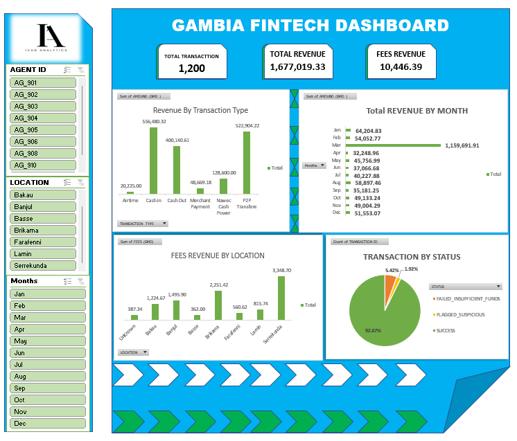

# 📊 [Project Title: Random Fintech Monthly Transaction & Revenue Performance Analysis]



---

## 📸 Executive Summary & Key Highlights
> **Brief Description:**
> 
> "This project analyzes synthetic transaction data from a leading Gambian fintech provider (1,200+ records) to evaluate revenue growth, regional adoption, and platform reliability. Using Microsoft Excel (Power Query, Pivot Tables, and Slicers), raw uncleaned data was transformed into an interactive executive dashboard to guide regional agent network expansion."

### 🔑 Key Performance Indicators (KPIs)
* **Total Processed Volume (GMV):** GMD 1,677,019.33
* **Gross Revenue Collected:** GMD 10,446.39
* **Transaction Success Rate:** 92.67%
* **Top Revenue Channel:** P2P Transfers & Cash In (~64% of total volume)

---

## 🎯 Business Problem & Objectives
1. **Revenue Optimization:** Which service types generate the highest fee margins for the company?
2. **Operational Reliability:** What percentage of transactions are failing, and what are the root causes?
3. **Geographic Distribution:** Which regions/districts are underperforming or driving maximum transaction volume?

---

## 🛠️ Tools & Technologies Used
* **Data Processing & Cleaning:** Microsoft Excel (Power Query / Text Functions / Data Validation)
* **Data Analysis & Aggregation:** Pivot Tables, Advanced Excel Formulas (`SUMIFS`, `COUNTIF`, `INT`)
* **Data Visualization:** Interactive Excel Dashboard (Slicers, Dynamic Charts, Custom Color Palette)
* **Documentation & Version Control:** Markdown / GitHub / Notion

---

## 🧹 Data Cleaning & Preprocessing Workflow

| Data Issue / Anomaly | Column Affected | Resolution Strategy Applied |
| :--- | :--- | :--- |
| **Inconsistent Categorical Text** | `location`, `gender` | Standardized text formatting using `TRIM()` and `UPPER()` in Excel/Power Query to remove duplicates like *"Serekunda"* vs. *"Serrekunda"*. |
| **Mixed Date/Time Formats** | `timestamp` | Used `Text to Columns` / Power Query Locale settings to standardize strings into clean `DD/MM/YYYY` date formats. |
| **Missing/Blank Values** | `location`, `fee_gmd` | Filled missing categorical values with `"Unknown"` using Go To Special/Power Query and imputed numeric fees based on business rules. |
| **Duplicate Entries** | `transaction_id` | Identified and removed ~25 duplicate rows to ensure accurate financial reporting. |

---

## 💡 Key Analytical Insights

1. **Cash-In & P2P Volume Lead Growth:** P2P Transfers (GMD 522.9K) and Cash-In transactions (GMD 556.5K) together represent over 60% of total platform value, proving that remittance and peer transfers drive core user retention.
2. **Regional Revenue Breakdown:** Serrekunda is the single largest fee revenue generator (GMD 2,764.58), followed by Brikama and Banjul. Provincial regions like Farafenni and Basse show high potential but currently lag in transaction volume.
3. **Platform Reliability & Risk:** Out of 1,200 total transactions, **92.67% succeeded**. The 7.33% non-success rate is primarily driven by **Insufficient Funds (5.42%)**, while **1.92%** were flagged as suspicious for risk/AML monitoring.

---

## 🚀 Business Recommendations
Translate your data findings into strategic actions for business decision-makers:

* **Optimize Agent Liquidity (Float):** Ensure high-volume agent locations in Serrekunda and Brikama have sufficient cash floats to handle peak Cash-Out periods and reduce failed attempts.
* **Incentivize App Adoption:** Encourage users to migrate from USSD to the Mobile App for P2P transfers via targeted promotions, reducing third-party USSD carrier costs.
* **Targeted Regional Marketing:** Launch marketing activations in growing hubs like Basse and Lamin to increase product awareness beyond the Greater Banjul Area.

---

## 📊 Interactive Dashboard Showcase


---

## 📁 Repository Structure
```text
├── data/
│   ├── raw_messy_data.csv          # Raw uncleaned input file
│   └── cleaned_data.xlsx           # Post-cleaning dataset
├── dashboards/
│   └── Gambia_Fintech_Dashboard.xlsx # Interactive Excel Workbook
└── README.md                       # Project Documentation
